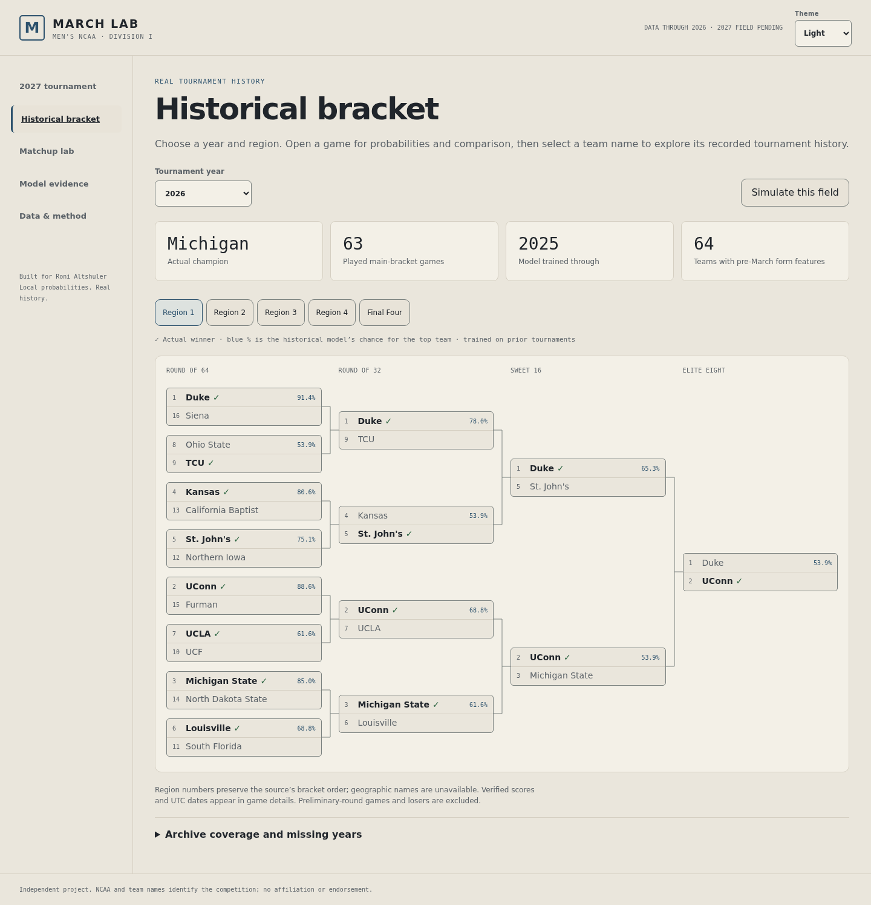

# Exploring March Lab

This guide describes the bundled browser experience. Coverage and model limits
are summarized in the [project README](../README.md), [data guide](DATA.md) and
[model guide](MODEL.md). Historical screenshots show their recorded revision.

The UI includes year and region navigation, interactive bracket graphs, matchup
details with available scores and dates, team comparisons, historical model
snapshots, exact advancement probabilities, reproducible bracket draws, a seed
matchup explorer, calibration and evaluation tables. It adapts to mobile and
supports keyboard operation. Its bracket-first navigation follows familiar
tournament conventions, with its own branding and no copied NCAA assets.
On mobile, a round selector gives a readable matchup list. On desktop/tablet,
the connected bracket scrolls inside its own frame.
The archive preserves the selected regional round when switching regions, years
or actual/simulated views. Final Four and Championship have a separate remembered
choice. Region, view and year controls retain keyboard focus, including when a delayed
simulation redraw replaces the currently focused region or round control. The current round
is saved in the URL for reload and returning from another page with Back/Forward;
opening a game restores its round and card focus when returning from a profile.
[Mobile region continuity](screenshots/bracket-navigation-region-mobile.png) ·
[Championship selection](screenshots/bracket-navigation-finals-mobile.png).

**Model bracket** fills a deterministic favorites path using the existing primary
seed model. Each picked winner feeds the next scheduled matchup; exactly 50–50
matchups use bracket order. The champion card shows the model's title chance
across all possible paths, the earlier training horizon and evidence on demand.
Model picks, one random draw and recorded results have separate views and labels.
The model view keeps diagnostics collapsed and restores its path on reload.

Historical picks are **conditional main-bracket experiments**: the bundled field
contains 64 main-bracket participants, including known preliminary survivors.
First Four games and losers are not ingested, so this is not a selection-day
full-field forecast. Unsupported/cancelled years and warm-up models remain
explicitly unavailable. The upcoming unknown field is never filled with guessed
entrants. A local imported field can declare opening pairs: their model-picked
winners feed its main bracket. Imports use the current seed snapshot and are
unverified scenarios, including imports labeled with an earlier year; they are
not historical as-of forecasts. Input timestamps are not invented.

This adds a transparent pick policy, not a new predictor, retraining or quality
claim. The seed baseline and all existing random draws/advancement probabilities
are preserved. The favorites policy has no new temporal score or pool-scoring
optimization claim. [Model view](screenshots/model-bracket-light-desktop.png) ·
[Mobile model picks](screenshots/model-bracket-light-mobile.png).

The bracket matchup dialog labels the selected comparison model and shows a
loading state while its saved probability is retrieved. Results and failures
belong to the open matchup and latest model choice: switching games or seasons,
closing the dialog, or choosing another model cannot replace the current view
with an older response. A failed comparison stays explicit; changing the model
retries it. This changes display behavior, not the saved probabilities or models.

The model evidence page includes a **Season evidence** inspector. Choose a year
to see played labels, score/date coverage, pre-March feature coverage, the saved
seed model's training and calibration horizons, and per-model evaluation scores.
Open that year's bracket directly from the inspector. Warm-up years, unavailable
form snapshots and cancelled 2020 are explicit; missing evaluations stay as
dashes. Feature availability does not imply that a form model could be trained
on enough earlier games. The inspector reads bundled artifacts without refitting
or promoting a challenger, and works in both local and static builds.
Its clear bracket action and visible primary model callout share the selected
palette with March Lab's navigation. Focus outlines,
responsive score tables and reduced-motion-aware control transitions support
keyboard and mobile exploration. Loading, cancelled and retry states remain
explicit rather than displaying old or invented scores.
[Desktop inspector](screenshots/season-evidence-desktop.png) ·
[Mobile inspector](screenshots/season-evidence-mobile.png).

Team names in historical game details open a **team tournament profile**. Browse
recorded appearances, seeds, final stages, opponents and available scores/dates,
then return to the originating bracket, region and game. The same journey works
with keyboard navigation, the mobile round list and the exported static app.
Recorded-appearance links always open actual results. Archive controls keep the
URL aligned with the displayed year, region, round and view for browser Back/Forward.
The latest sampled draw per year survives browsing other seasons during the
session; reloading switches to explicitly labeled actual results.
The cream/navy profile uses text initials; no team logos or player portraits are
downloaded, and rosters/player statistics are unavailable.

Modern appearances join only through the existing per-season verified ESPN IDs.
Older records use a separate exact archive-key namespace and do not contribute
to modern school totals. Similar names never establish identity: the archive
label `SanDiego` represents San Diego in 2008 and UC San Diego in 2025;
`Lafayette` represents Lafayette in 2015 and Louisiana in 2023. Profiles keep
these verified identities separate and offer clearly scoped related-record
links. Appearance counts, titles and played wins–losses describe only that
profile's bundled main-bracket records, not a complete school career.
No-contests are listed separately; cancelled 2020, missing years and failed
loads remain explicit. No sources, model fitting or prediction claims change.
[Desktop profile](screenshots/team-profile-desktop.png) ·
[Mobile profile](screenshots/team-profile-mobile.png).

Matchup Lab also includes a **recorded matchup comparison**. Open it from actual
game details, or choose an archived year and matchup in the lab. Three cards show
the saved seed baseline and eligible challengers for the same game, with both
teams' numeric probabilities, training horizons and percentage-point gaps from
the baseline. Swap the displayed team sides, follow their existing histories,
inspect that year's evidence or open the actual bracket. Browser Back/Forward
preserves the comparison selection; simulated game details remain distinct.

Warm-up snapshots, the 2006 form-coverage/model-availability boundary, cancelled
2020 and no-contests stay explicit. Missing probabilities are dashes, and model
gaps are not confidence intervals or evidence that a challenger is better. The
feature reuses native controls, the season-evidence theme, profile links and the
existing prediction API/static tables. It adds no UI dependencies, assets,
sources, training or model promotion.
[Desktop comparison](screenshots/matchup-comparison-populated-desktop.png) ·
[Mobile comparison](screenshots/matchup-comparison-populated-mobile.png).

Team profiles also include a **historical scouting dossier** for the selected
recorded appearance. Elo, win rate and scoring margin show March 1 values and
percentiles among covered entrants in that tournament. The lookback control
compares the last 3, last 5 or all earlier appearances in the same stored identity:
recorded wins versus the sum of saved seed probabilities on those same matchups.
Current and later tournament results are excluded from that earlier-results signal.

This is descriptive evidence on observed paths, not expected full-bracket wins,
national team rankings, player value or a future strength forecast. Missing form,
warm-up models, no-contests, missing identities and cancelled appearances remain
explicit; no confidence interval is estimated. The dossier reuses existing
features and strictly earlier-trained annual snapshots without fitting or
promoting a model. Source schedules may be incomplete, and old archive keys are
kept separate from verified modern school identities.
The field cohort is conditional on preliminary-round survivors; the dossier
is retrospective context, not a selection-day full-field forecast.
[Desktop dossier](screenshots/team-scouting-populated-desktop.png) ·
[Mobile dossier](screenshots/team-scouting-populated-mobile.png).

The whole navigation journey shares March Lab's blue/gold identity and palette:
cream/off-white light surfaces or a dark workspace. The header's **Theme** control
offers System, Light and Dark. The choice is initialized before styles render,
saved locally when storage is available, and carried through the bracket, matchup
details, profiles/scouting, comparisons, evidence, method and request states.
System follows changes to the device preference; an explicit choice overrides it.
Blocked storage keeps the current visit usable but cannot persist a choice.

[Light desktop](screenshots/theme-home-light-desktop.png) ·
[Light mobile](screenshots/theme-home-light-mobile.png) ·
[Dark profile](screenshots/theme-profile-dark-mobile.png) ·
[Dark comparison](screenshots/theme-comparison-dark-desktop.png).

